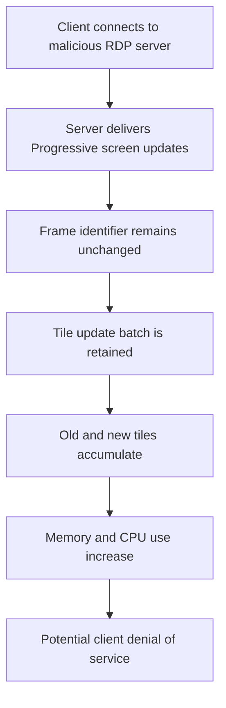

# GhostTiles — FreeRDP Progressive Codec Security Research

# 👻 GhostTiles
### Unbounded Resource Amplification in FreeRDP's Progressive Codec

**Security Research • Client-Side Denial of Service • Responsible Disclosure**

**Researcher: Saurabh Pal**

---

## Overview

GhostTiles is a client-side resource-exhaustion vulnerability identified during security research into FreeRDP's Progressive graphics decoder.

When the RDP server repeatedly sends Progressive surface updates without advancing the frame identifier, the decoder may retain stale tile-update entries across decompression calls.

This results in increasing memory consumption and repeated rendering work. A malicious RDP server can potentially cause denial of service in a vulnerable FreeRDP client that connects to it.

**This repository documents the research and observed results. Exploit payloads and reproduction details are withheld during coordinated disclosure.**

## Key Findings

| Metric | Laboratory observation |
|---|---|
| Affected component | libfreerdp/codec/progressive.c |
| Tested stable release | 3.32.2 |
| Additional tested build | 3.32.3-dev0 |
| Surface commands | 150 |
| Payload per command | 82,325 bytes |
| Total payload data | ~12.3 MB |
| Initial client RSS | ~2.2 MB |
| Observed peak RSS | ~2,290 MB |
| Payload-to-memory amplification | ~186× |
| Primary impact | Client resource exhaustion |
| CWE candidates | CWE-400 / CWE-407 / CWE-789 |
| CVE status | Pending assessment |

Results are measurements from a controlled test environment, not estimates of worldwide exposure.

## How GhostTiles Works

A FreeRDP client decodes screen updates received from an RDP server. Updated screen regions are represented internally as tiles.

The vulnerable behavior occurs when the decoder retains previously updated tiles rather than clearing the update batch between processing operations when the frame identifier remains unchanged.

Consequences include:

- Accumulation of stale tile-update entries
- Excessive memory growth
- Repeated rendering of previously processed tiles
- Increasing CPU processing costs
- Potential client freeze or denial of service

## Conceptual Flow

## Observed Impact

An instrumented FreeRDP sample server was connected to a real FreeRDP client over TCP/TLS.

During the experiment, approximately 12.3 MB of encoded Progressive payload data corresponded to a client resident-memory increase from approximately 2.2 MB to 2,290 MB.

The reported research also includes a separate constrained-memory termination experiment. A client process being stopped during test cleanup must not be mistaken for an independently verified crash.

## Root Cause

**Component:** `libfreerdp/codec/progressive.c`

**Function:** `progressive_decompress()`

The update-batch reset condition is tied to changes in the frame identifier. When that identifier remains constant across calls, previously accumulated tile-update entries can remain in the batch.

This creates a resource-amplification condition.

## Additional Research Findings

The broader investigation documented several separate candidate issues:

| ID | Finding | Evidence or limitation |
|---|---|---|
| F1 | Same-frameId resource amplification | End-to-end laboratory evidence |
| F2 | Allocation-failure state inconsistency and heap out-of-bounds write | Fault-injection ASAN finding; remote exploitability not established |
| F3 | Decoder error-propagation behavior | Runtime research finding |
| F4 | Encoder output-buffer lifetime concern | Caller/API-contract analysis needed |

**No remote code execution is claimed or demonstrated by this publication.**

## Security Impact and Preconditions

The primary attack surface is the **FreeRDP client**, not an arbitrary RDP server.

Successful exploitation of the demonstrated resource-exhaustion condition requires a vulnerable client to process graphics updates from an attacker-controlled or compromised RDP server.

Merely having FreeRDP installed is not sufficient to trigger the issue.

## Recommended Mitigations

- Correctly clear tile-update batches at appropriate decode-operation boundaries
- Ensure cache expansion handles allocation failures transactionally
- Propagate decoder errors consistently
- Apply supported FreeRDP security updates when available
- Avoid connecting to untrusted RDP endpoints

Proposed source fixes require upstream maintainer review.

## Coordinated Disclosure

This issue has been privately reported to the FreeRDP security team.

CVE assignment, affected-version scope, final severity, and remediation status remain subject to upstream confirmation.

Detailed reproduction artifacts and working payloads are intentionally excluded while the vendor disclosure process is ongoing.

Security reports should be directed to the FreeRDP project through its official private reporting channels:

https://github.com/FreeRDP/FreeRDP/security

## Researcher

**Saurabh Pal**  
 Security Researcher

Research project: **GhostTiles — FreeRDP Progressive Codec**

## Disclaimer

This repository is intended for defensive security research, technical education, and responsible vulnerability disclosure. The results reflect controlled laboratory observations and should not be interpreted as proof of remote code execution or universal exploitability.

---

**GhostTiles | Research by Saurabh Pal| CVE Pending**
